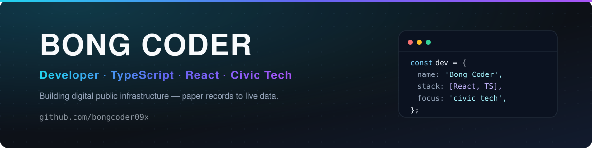

  

  

 

## About

I build software for problems that matter on the ground — the kind where a paper
register, a slow counter, and a citizen without a smartphone are still part of the
requirements.

Right now that means **Smart Bhumi**, a land-record digitisation and validation
system: upload a record, extract it, validate it, map it, and let a citizen verify
it without a queue.

- **Focus** — full-stack product engineering, civic and geospatial tech
- **Stack** — React 19, TypeScript, Tailwind, Node/Express, Supabase (Postgres), Leaflet
- **Interested in** — AI-assisted document extraction, offline-tolerant workflows, accessible interfaces
- **Open to** — collaboration on public-interest software and hackathon builds

 

## Tech I work with

 

## Featured work

<table>
<tr>
<td width="50%" valign="top">

### Smart Bhumi
Land-record digitisation and validation — upload, extract, review, map, verify.

`React 19` `TypeScript` `Supabase` `Leaflet` `Gemini`

**[→ bongcoder09x/SMART-BHUM-](https://github.com/bongcoder09x/SMART-BHUM-)**

</td>
<td width="50%" valign="top">

### Bong Coder
The home repo — notes, experiments, and things being figured out in public.

`TypeScript` `React` `Vite`

**[→ bongcoder09x/Bong-Coder](https://github.com/bongcoder09x/Bong-Coder)**

</td>
</tr>
</table>

 

## GitHub in numbers

 

  

 

### Let's build something useful

Open an issue on any repo if you want to talk about a build.

  

